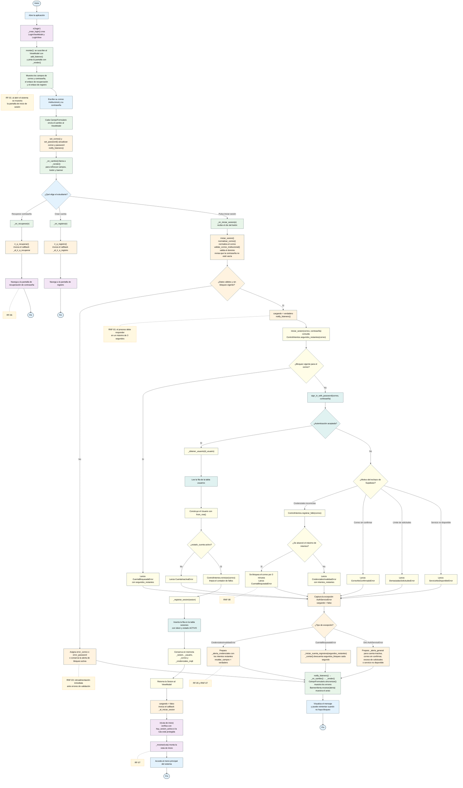

# Diagrama de flujo — Módulo Login (Mermaid)

Proceso de inicio de sesión del estudiante (MVVM). Equivale a `DiagramaFlujoModuloLogin.puml`.

**Cómo leerlo:** cada cuadro pertenece a un actor o capa, que se distingue por su color. Los rombos son decisiones, los óvalos son inicio y fin, y los cuadros punteados son notas con el requisito que se cumple (RF, RNF o RN).

| Color | Actor o capa |
|---|---|
| Azul | Estudiante |
| Morado | Router |
| Verde | LoginView (View) |
| Naranja | LoginViewModel |
| Amarillo | AuthService |
| Verde azulado | Supabase |

