# Diagrama de flujo — Módulo Modificación de usuarios (Mermaid)

Perfil del estudiante y cambio de contraseña (MVVM). Equivale a `DiagramaFlujoModuloModificacionUsuario.puml`.

**Cómo leerlo:** cada cuadro pertenece a un actor o capa, que se distingue por su color. Los rombos son decisiones, los óvalos son inicio y fin, y los cuadros punteados son notas con el requisito que se cumple (RF, RNF o RN). Después de la pantalla de perfil el flujo se bifurca en dos partes: **Parte A, actualizar perfil**, y **Parte B, cambiar contraseña**. Ambas se repiten (flecha hacia atrás) hasta que el cambio se guarda.

En los carriles View y ViewModel participan `PerfilView` y `CambiarPasswordView`, con sus respectivos ViewModel.

| Color | Actor o capa |
|---|---|
| Azul | Estudiante |
| Morado | Inicio y Router |
| Verde | View (PerfilView o CambiarPasswordView) |
| Naranja | ViewModel (PerfilViewModel o CambiarPasswordViewModel) |
| Amarillo | AuthService |
| Verde azulado | Supabase |
| Gris | EmqxAdminService |

```mermaid
flowchart TD
  classDef est fill:#E3F2FD,stroke:#455A64,color:#000
  classDef rou fill:#F3E5F5,stroke:#455A64,color:#000
  classDef vie fill:#E8F5E9,stroke:#455A64,color:#000
  classDef vm fill:#FFF3E0,stroke:#455A64,color:#000
  classDef aut fill:#FFFDE7,stroke:#455A64,color:#000
  classDef sup fill:#E0F2F1,stroke:#455A64,color:#000
  classDef emq fill:#ECEFF1,stroke:#455A64,color:#000
  classDef nota fill:#FFF8E1,stroke:#F9A825,color:#000,stroke-dasharray:4 3

  n1(["Inicio"]):::est --> n2["Con sesión iniciada, abre el menú lateral de Inicio<br/>y elige Mi perfil"]:::est
  n2 --> n3["MenuSandwich invoca on_mi_perfil<br/>InicioView._on_mi_perfil(e) → InicioViewModel.ir_a_perfil()<br/>Router._crear_perfil() crea PerfilViewModel y PerfilView"]:::rou
  n3 -.- t1["RF-01: solo con estudiante autenticado"]:::nota
  n3 --> n4["PerfilView.montar(): se suscribe al ViewModel con add_listener()"]:::vie
  n4 --> n5["Carga nombre, apellidos y medio_transporte<br/>desde AuthService.usuario_actual<br/>perfil_cargado = verdadero"]:::vm
  n5 --> n6["_render() muestra los campos de nombre y apellidos,<br/>las tarjetas de transporte y el correo<br/>como campo de solo lectura"]:::vie
  n6 -.- t2["RF-02 y RNF-03: el correo institucional<br/>se muestra, pero no se puede editar"]:::nota
  n6 --> n7{"¿Qué elige el estudiante?"}:::est

  n7 -->|"Regresar"| n8["_on_regresar(e)"]:::vie
  n8 --> n9["regresar() invoca el callback _al_regresar"]:::vm
  n9 --> n10["Navega de regreso a Inicio"]:::rou
  n10 --> f1(["Fin"]):::est

  n7 -->|"Cambiar la contraseña"| n20["_on_cambiar_password(e)"]:::vie
  n7 -->|"Edita sus datos"| n60["PARTE A — Edita su nombre, sus apellidos<br/>o elige Automóvil o Motocicleta"]:::est

  %% ===== PARTE B: CAMBIAR CONTRASEÑA =====
  n20 --> n21["PerfilViewModel.ir_a_cambiar_password()<br/>invoca el callback _al_ir_a_cambiar_password"]:::vm
  n21 --> n22["Router._crear_cambiar_password() crea<br/>CambiarPasswordViewModel con AuthService y EmqxAdminService<br/>y la CambiarPasswordView"]:::rou
  n22 --> n23["Muestra los campos de contraseña actual, nueva y confirmación<br/>y la ListaRequisitos"]:::vie
  n23 --> n24["PARTE B — Escribe su contraseña actual,<br/>la nueva y la confirmación"]:::est
  n24 --> n25["CampoFormulario envía cada cambio al ViewModel"]:::vie
  n25 --> n26["set_actual, set_nueva y set_confirmar llaman a _cambio(campo)<br/>Se revalida y se actualiza requisitos_password<br/>notify_listeners()"]:::vm
  n26 --> n27["_on_cambio() → _render()<br/>ListaRequisitos.sincronizar() marca los requisitos cumplidos<br/>CampoFormulario muestra los errores"]:::vie
  n27 -.- t3["RNF-01: formato de la nueva contraseña<br/>RNF-04: retroalimentación inmediata"]:::nota
  n27 --> n28{"¿Qué elige el estudiante?"}:::est
  n28 -->|"Regresar"| n29["_on_regresar(e)"]:::vie
  n29 --> n30["regresar() invoca el callback _al_regresar"]:::vm
  n30 --> n31["Navega de regreso al perfil"]:::rou
  n31 --> f2(["Fin"]):::est
  n28 -->|"Pulsa Actualizar"| n32["_on_actualizar(e) recibe el clic del botón"]:::vie
  n32 --> n33["actualizar()<br/>_validar(): campos requeridos, estado_requisitos_password()<br/>y que la confirmación coincida con la nueva"]:::vm
  n33 --> n34{"¿Datos válidos?"}:::vm
  n34 -->|"No"| n35["Asigna error_actual, error_nueva o error_confirmar"]:::vm
  n35 -.- t4["RF-03"]:::nota
  n35 --> n58
  n34 -->|"Sí"| n36["cargando = verdadero<br/>llama a AuthService.cambiar_password<br/>con actual, nueva y sincronizar_mqtt = crear_credencial"]:::vm
  n36 --> n37["cambiar_password(actual, nueva, sincronizar_mqtt)<br/>Usa correo_actual para verificar la contraseña actual"]:::aut
  n37 -.- t5["RF-04"]:::nota
  n37 --> n38["Verifica la contraseña actual del estudiante"]:::sup
  n38 --> n39{"¿La contraseña actual es correcta?"}:::sup

  n39 -->|"Sí"| n40["_actualizar_password_auth(nueva)"]:::aut
  n40 --> n41["Actualiza la contraseña en Authentication"]:::sup
  n41 -.- t6["RNF-02: se almacena cifrada"]:::nota
  n41 --> n42{"¿Supabase aceptó la nueva contraseña?"}:::sup
  n42 -->|"Sí"| n43["Ejecuta sincronizar_mqtt(correo, nueva)"]:::aut
  n43 --> n44["crear_credencial(correo, nueva)<br/>La contraseña MQTT queda igual a la nueva"]:::emq
  n44 --> n45{"¿EMQX devolvió un error?"}:::emq
  n45 -->|"Sí"| n46["Revierte la contraseña en Authentication<br/>Lanza CambioPasswordRevertidoError"]:::aut
  n45 -->|"No"| n47["Renueva las CredencialesMqtt en memoria"]:::aut
  n42 -->|"No"| n48{"¿Motivo del rechazo?"}:::aut
  n48 -->|"Contraseña débil"| n49["Lanza PasswordDebilError"]:::aut
  n48 -->|"Igual a la anterior"| n50["Lanza PasswordRepetidaError"]:::aut
  n48 -->|"Sin sesión activa"| n51["Lanza SinSesionError"]:::aut

  n39 -->|"No"| n52["Cuenta el intento fallido de contraseña actual"]:::aut
  n52 --> n53{"¿Se alcanzó el límite de intentos?"}:::aut
  n53 -->|"Sí"| n54["Lanza CuentaBloqueadaError"]:::aut
  n53 -->|"No"| n55["Lanza PasswordActualIncorrectaError<br/>con intentos_restantes"]:::aut

  n46 --> n56
  n47 --> n56
  n49 --> n56
  n50 --> n56
  n51 --> n56
  n54 --> n56
  n55 --> n56
  n56{"¿AuthService lanzó una excepción?"}:::vm
  n56 -->|"Sí"| n57["Captura el AuthServiceError<br/>cargando = falso"]:::vm
  n57 --> n57b{"¿Tipo de excepción?"}:::vm
  n57b -->|"PasswordActualIncorrectaError o CuentaBloqueadaError"| n57c["Asigna error_actual con los intentos restantes<br/>o con el aviso de bloqueo"]:::vm
  n57b -->|"PasswordDebilError o PasswordRepetidaError"| n57d["Asigna error_nueva con el mensaje correspondiente"]:::vm
  n57b -->|"Otro AuthServiceError"| n57e["Prepara una Alerta general<br/>para cambio revertido, sesión inexistente o falla del servicio"]:::vm
  n56 -->|"No"| n57f["cargando = falso<br/>completado = verdadero"]:::vm
  n57c --> n58
  n57d --> n58
  n57e --> n58
  n57f --> n58
  n58["_on_cambio() → _render()<br/>Muestra errores, alerta o la PantallaExito"]:::vie
  n58 --> n59{"¿Contraseña actualizada?"}:::vie
  n59 -->|"No"| n24
  n59 -->|"Sí"| n59b["Invoca el callback _al_cambiar"]:::vm
  n59b --> n59c["Router._password_cambiada() atiende el cambio de contraseña"]:::rou
  n59c --> n59d["PantallaExito confirma que la contraseña fue actualizada"]:::vie
  n59d -.- t7["RF-05"]:::nota
  n59d --> f3(["Fin"]):::est

  %% ===== PARTE A: ACTUALIZAR PERFIL =====
  n60 --> n61["CampoFormulario y TarjetaOpcion envían cada cambio al ViewModel"]:::vie
  n61 --> n62["set_nombre, set_apellido_paterno, set_apellido_materno<br/>y set_medio_transporte llaman a _cambio(campo)<br/>Se validan los datos y se recalculan hay_cambios y puede_guardar<br/>notify_listeners()"]:::vm
  n62 --> n63["_on_cambio() → _render()<br/>CampoFormulario.sincronizar() muestra los errores<br/>El botón Guardar se habilita solo si hay cambios válidos"]:::vie
  n63 -.- t8["RNF-04"]:::nota
  n63 --> n64{"¿Qué elige el estudiante?"}:::est
  n64 -->|"Regresar"| n65["_on_regresar(e)"]:::vie
  n65 --> n66["regresar() invoca el callback _al_regresar"]:::vm
  n66 --> n67["Navega de regreso a Inicio sin guardar los cambios"]:::rou
  n67 --> f4(["Fin"]):::est
  n64 -->|"Pulsa Guardar"| n68["_on_guardar(e) recibe el clic del botón"]:::vie
  n68 --> n69["guardar()<br/>_validar(): normalizar_nombre() y validar_nombre_apellido_persona()<br/>Se revisa que haya un medio de transporte elegido"]:::vm
  n69 --> n70{"¿Datos con formato válido?"}:::vm
  n70 -->|"No"| n71["Llena errores por campo"]:::vm
  n71 -.- t9["RF-03"]:::nota
  n71 --> n91
  n70 -->|"Sí"| n72["cargando = verdadero<br/>guardar() llama a AuthService.actualizar_perfil"]:::vm
  n72 --> n73["actualizar_perfil(nombre, apellido_paterno,<br/>apellido_materno, medio_transporte)"]:::aut
  n73 --> n74["Si cambió el medio de transporte<br/>consulta si el estudiante tiene una reserva activa"]:::sup
  n74 --> n75{"¿Cambia el transporte con una reserva activa?"}:::sup
  n75 -->|"Sí"| n76["Lanza MedioTransporteBloqueadoError"]:::aut
  n76 -.- t10["RF-07"]:::nota
  n75 -->|"No"| n77["Actualiza la fila de usuarios<br/>con todos los campos en una sola operación"]:::sup
  n77 -.- t11["RNF-05: cambios atómicos"]:::nota
  n77 --> n78{"¿Supabase actualizó el perfil?"}:::sup
  n78 -->|"Sí"| n79["Actualiza el Usuario guardado en memoria<br/>y lo retorna al ViewModel"]:::aut
  n78 -->|"No"| n80{"¿Motivo del rechazo?"}:::aut
  n80 -->|"Sin sesión activa"| n81["Lanza SinSesionError"]:::aut
  n80 -->|"Dato inválido"| n82["Lanza DatosInvalidosError con el campo"]:::aut
  n76 --> n83
  n79 --> n83
  n81 --> n83
  n82 --> n83
  n83{"¿AuthService lanzó una excepción?"}:::vm
  n83 -->|"Sí"| n84["Captura el AuthServiceError<br/>cargando = falso"]:::vm
  n84 --> n85{"¿Tipo de excepción?"}:::vm
  n85 -->|"MedioTransporteBloqueadoError"| n86["aviso_reserva indica que primero debe<br/>finalizar o cancelar su reserva"]:::vm
  n85 -->|"DatosInvalidosError"| n87["Guarda el mensaje en errores del campo indicado"]:::vm
  n85 -->|"Otro AuthServiceError"| n88["Prepara una Alerta general"]:::vm
  n83 -->|"No"| n89["cargando = falso<br/>guardado = verdadero<br/>mensaje_exito"]:::vm
  n86 --> n91
  n87 --> n91
  n88 --> n91
  n89 --> n91
  n91["_on_cambio() → _render()<br/>Muestra errores, BannerAlerta de reserva o alerta general<br/>o BannerExito si se guardó"]:::vie
  n91 --> n92{"¿Perfil guardado?"}:::vie
  n92 -->|"No"| n60
  n92 -->|"Sí"| n93["Invoca el callback _al_guardar"]:::vm
  n93 --> n94["Router._perfil_actualizado() atiende la actualización del perfil"]:::rou
  n94 --> n95["BannerExito.mostrar(mensaje_exito) confirma el cambio"]:::vie
  n95 -.- t12["RF-05"]:::nota
  n95 --> f5(["Fin"]):::est
```

