# Diagrama de flujo — Módulo Visualización de ocupación (Mermaid)

Snapshot inicial, suscripción MQTT y actualización en tiempo real (MVVM). Equivale a `DiagramaFlujoModuloOcupacionCajones.puml`.

**Cómo leerlo:** cada cuadro pertenece a un actor o capa, que se distingue por su color. Los rombos son decisiones, los óvalos son inicio y fin, y los cuadros punteados son notas con el requisito que se cumple (RF, RNF o RN). El ciclo de tiempo real se repite (flecha hacia atrás) mientras la sesión del estudiante siga activa.

| Color | Actor o capa |
|---|---|
| Azul | Estudiante |
| Morado | Router |
| Verde | OcupacionView (View) |
| Naranja | OcupacionViewModel |
| Amarillo | CajonesService |
| Verde azulado | MqttService |
| Gris | ESP32 y broker EMQX |

```mermaid
flowchart TD
  classDef est fill:#E3F2FD,stroke:#455A64,color:#000
  classDef rou fill:#F3E5F5,stroke:#455A64,color:#000
  classDef vie fill:#E8F5E9,stroke:#455A64,color:#000
  classDef vm fill:#FFF3E0,stroke:#455A64,color:#000
  classDef svc fill:#FFFDE7,stroke:#455A64,color:#000
  classDef mqt fill:#E0F2F1,stroke:#455A64,color:#000
  classDef emq fill:#ECEFF1,stroke:#455A64,color:#000
  classDef nota fill:#FFF8E1,stroke:#F9A825,color:#000,stroke-dasharray:4 3

  n1(["Inicio"]):::est --> n2["Con sesión iniciada, abre la sección de Ocupación"]:::est
  n2 --> n3["ir('ocupacion')<br/>_crear_ocupacion() obtiene el ViewModel<br/>con _ocupacion_de_sesion()"]:::rou
  n3 --> n4{"¿Ya existe el ViewModel de la sesión?"}:::rou
  n4 -->|"No"| n5["Crea el OcupacionViewModel único de la sesión<br/>y llama a iniciar()"]:::rou
  n5 -.- t1["Un solo ViewModel por sesión<br/>implica una sola conexión MQTT"]:::nota
  n4 -->|"Sí"| n6["Reutiliza el ViewModel existente<br/>sin abrir otra conexión"]:::rou
  n5 --> n7["Crea la OcupacionView con ese ViewModel"]:::rou
  n6 --> n7
  n7 --> n8["montar(): se suscribe al ViewModel con add_listener()<br/>y pinta con _render() el estado de carga"]:::vie

  %% ===== ARRANQUE: SNAPSHOT INICIAL Y CONEXIÓN MQTT =====
  n8 --> n10["iniciar(): cargando = verdadero<br/>_cargar_snapshot()"]:::vm
  n10 --> n11["obtener_estado_actual()<br/>Lee la tabla cajones de Supabase"]:::svc
  n11 -.- t2["RNF-01: máximo de 5 segundos"]:::nota
  n11 --> n12{"¿Se obtuvo el snapshot a tiempo?"}:::svc
  n12 -->|"Sí"| n13["Devuelve C1 a C4 en orden como CajonEstacionamiento<br/>Un cajón faltante o dado de baja se devuelve como NO_CONECTADO<br/>Las filas inválidas se descartan"]:::svc
  n13 --> n14["Carga el estado inicial de cada cajón<br/>en _sensor y _ids"]:::vm
  n12 -->|"No"| n15["Lanza CajonesNoDisponiblesError"]:::svc
  n15 --> n16["error_snapshot = verdadero<br/>La pantalla sigue funcionando<br/>y MQTT irá llenando los cajones"]:::vm
  n14 --> n17["cargando = falso<br/>notify_listeners()"]:::vm
  n16 --> n17
  n17 --> n18["_conectar_mqtt()<br/>Toma AuthService.credenciales_mqtt<br/>estado_conexion = CONECTANDO"]:::vm
  n18 --> n19["Inicia _tarea_reloj<br/>que ejecuta _tic() cada segundo"]:::vm
  n19 --> n20["conectar(usuario, password, al_recibir,<br/>al_cambiar_estado, al_recibir_sistema)<br/>Conexión TLS con paho al broker EMQX"]:::mqt
  n20 --> n21["EMQX valida las credenciales del estudiante<br/>y permite suscribirse a los tópicos<br/>de ocupación y de sistema"]:::emq
  n21 --> n22["_on_connect(): suscripción QoS 1<br/>al tópico de ocupación y al tópico del sistema<br/>_notificar(CONECTADO)"]:::mqt
  n22 --> n23["_cambiar_estado(CONECTADO)<br/>estado_conexion = CONECTADO"]:::vm
  n23 --> n24["_on_cambio() → _render()<br/>TarjetaCajon.sincronizar() pinta C1 a C4<br/>PildoraConexion muestra En vivo<br/>Se muestran disponibilidad y última actualización"]:::vie
  n24 -.- t3["RF-01, RF-02 y RF-03: disponibilidad actual,<br/>estado de cada cajón y total disponible<br/>RNF-07: estados distinguibles por color"]:::nota

  %% ===== TIEMPO REAL: se repite mientras la sesión esté activa =====
  n24 --> n40{"¿Qué ocurre?"}:::vm

  n40 -->|"Un nodo cambia de estado"| n41["El ESP32 lee los sensores infrarrojos del módulo<br/>Cuando el cambio se mantiene estable<br/>publica un JSON con id_modulo y estado"]:::emq
  n41 -.- t4["RF-04, RF-05 y RF-09"]:::nota
  n41 --> n42["EMQX entrega el mensaje a los suscriptores"]:::emq
  n42 --> n43["_on_message(): EventoOcupacion.from_payload(payload, origen)"]:::mqt
  n43 --> n44{"¿El mensaje tiene formato válido?"}:::mqt
  n44 -->|"No"| n45["Lanza PayloadInvalidoError<br/>Se registra en el log y se descarta el mensaje<br/>los demás cajones no se afectan"]:::mqt
  n44 -->|"Sí"| n46["al_recibir(evento) pasa el evento al hilo<br/>de la interfaz con call_soon_threadsafe"]:::mqt
  n46 --> n47["_recibir_evento(evento)<br/>Actualiza _sensor y _ultimo_reporte de la etiqueta<br/>estado_efectivo(sensor, sistema) define el estado mostrado<br/>Recalcula libres, ocupados y porcentaje_ocupado<br/>notify_listeners()"]:::vm
  n47 -.- t5["RF-06, RNF-02 y RNF-09"]:::nota

  n40 -->|"Llega un mensaje del sistema"| n50["_on_message(): EventoSistema.from_payload(payload)<br/>al_recibir_sistema(evento)"]:::mqt
  n50 --> n51["_recibir_sistema(evento)<br/>Actualiza _sistema de la etiqueta con BLOQUEADO,<br/>RESERVADO o LIBERADO y registra el aviso<br/>estado_efectivo() combina sensor y sistema<br/>notify_listeners()"]:::vm

  n40 -->|"Pasa un segundo"| n55["_tic(): _revisar_nodos()<br/>actualiza texto_actualizado"]:::vm
  n55 --> n56{"¿Algún nodo supera _timeout_nodo sin reportar?"}:::vm
  n56 -->|"Sí"| n57["Marca ese cajón como NO_CONECTADO<br/>y notify_listeners()"]:::vm
  n57 -.- t6["RF-07 y RNF-03"]:::nota

  n40 -->|"Cambia la conexión con el broker"| n60["_on_connect() o _on_disconnect()<br/>_notificar(estado)"]:::mqt
  n60 --> n61["_cambiar_estado(estado)<br/>estado_conexion = estado<br/>La píldora muestra En vivo, Conectando,<br/>Reconectando, Sin acceso o Sin conexión"]:::vm
  n61 --> n62{"¿El estado es CREDENCIALES_INVALIDAS?"}:::vm
  n62 -->|"Sí"| n63["_sincronizar_y_reconectar(credenciales)"]:::vm
  n63 --> n64["EmqxAdminService.crear_credencial()<br/>vuelve a registrar la credencial del estudiante"]:::emq
  n64 --> n65["Se reconecta con las credenciales sincronizadas"]:::mqt

  n40 -->|"El estudiante toca una tarjeta"| n70["Toca la tarjeta de un cajón seleccionable"]:::est
  n70 --> n71["_al_tocar(etiqueta) devuelve el manejador del clic"]:::vie
  n71 --> n72["reservar(etiqueta)<br/>El flujo continúa en el módulo de Reserva de cajón"]:::vm

  %% ===== UNIÓN: la vista se actualiza y el ciclo continúa =====
  n45 --> n80
  n47 --> n80
  n51 --> n80
  n56 -->|"No"| n80
  n57 --> n80
  n62 -->|"No"| n80
  n65 --> n80
  n72 --> n80
  n80["Si el ViewModel notificó un cambio<br/>_on_cambio() llama a _render()<br/>actualiza tarjetas, contadores, píldora y texto_actualizado"]:::vie
  n80 --> n81{"¿Continúa la sesión del estudiante?"}:::vie
  n81 -->|"Sí"| n40

  %% ===== CIERRE DE SESIÓN =====
  n81 -->|"No"| n90["Cierra sesión"]:::est
  n90 --> n91["_detener_ocupacion() libera el ViewModel de la sesión"]:::rou
  n91 --> n92["detener(): cancela _tarea_reloj"]:::vm
  n92 --> n93["desconectar(): cierra la sesión en EMQX<br/>sin intentar reconectar"]:::mqt
  n93 --> f1(["Fin"]):::est
```

