# Diagrama de flujo — Módulo Registro de usuarios (Mermaid)

Proceso de registro de un nuevo estudiante (MVVM). Equivale a `DiagramaFlujoModuloRegistro.puml`.

**Cómo leerlo:** cada cuadro pertenece a un actor o capa, que se distingue por su color. Los rombos son decisiones, los óvalos son inicio y fin, y los cuadros punteados son notas con el requisito que se cumple (RF, RNF o RN).

| Color | Actor o capa |
|---|---|
| Azul | Estudiante |
| Morado | Router |
| Verde | RegistroView (View) |
| Naranja | RegistroViewModel |
| Amarillo | AuthService |
| Verde azulado | Supabase |
| Gris | EmqxAdminService |

```mermaid
flowchart TD
  classDef est fill:#E3F2FD,stroke:#455A64,color:#000
  classDef rou fill:#F3E5F5,stroke:#455A64,color:#000
  classDef vie fill:#E8F5E9,stroke:#455A64,color:#000
  classDef vm fill:#FFF3E0,stroke:#455A64,color:#000
  classDef aut fill:#FFFDE7,stroke:#455A64,color:#000
  classDef sup fill:#E0F2F1,stroke:#455A64,color:#000
  classDef emq fill:#ECEFF1,stroke:#455A64,color:#000
  classDef nota fill:#FFF8E1,stroke:#F9A825,color:#000,stroke-dasharray:4 3

  n1(["Inicio"]):::est --> n2["Elige Crear cuenta en la pantalla de Login"]:::est
  n2 --> n3["ir('registro')<br/>_crear_registro() crea RegistroViewModel y RegistroView"]:::rou
  n3 --> n4["montar(): se suscribe al ViewModel con add_listener()<br/>y pinta el formulario con _render()"]:::vie
  n4 --> n5["Muestra los campos de nombre, apellidos, correo,<br/>contraseña y confirmación, las tarjetas de transporte<br/>y la lista de requisitos de contraseña"]:::vie
  n5 --> n6["Captura sus datos y elige<br/>Automóvil o Motocicleta"]:::est
  n6 --> n7["Cada CampoFormulario y TarjetaOpcion<br/>envía el cambio al ViewModel"]:::vie
  n7 --> n8["set_nombre, set_apellido_paterno, set_apellido_materno,<br/>set_medio_transporte, set_correo, set_password<br/>y set_confirmar_password llaman a _cambio(campo)"]:::vm
  n8 --> n9["Si _validar_en_vivo está activo se revalida el campo<br/>luego notify_listeners()"]:::vm
  n9 --> n10["_on_cambio() llama a _render()<br/>CampoFormulario.sincronizar() refresca valores y errores<br/>ListaRequisitos.sincronizar() marca los requisitos cumplidos"]:::vie
  n10 -.- t1["RNF-03: retroalimentación inmediata<br/>RNF-05: requisitos de la contraseña<br/>visibles mientras se escribe"]:::nota
  n10 --> n11{"¿Qué elige el estudiante?"}:::est

  n11 -->|"Ir al login"| n12["_on_ir_a_login(e)"]:::vie
  n12 --> n13["ir_a_login() invoca el callback de navegación"]:::vm
  n13 --> n14["Navega a la pantalla de Login"]:::rou
  n14 --> f1(["Fin"]):::est

  n11 -->|"Recuperar contraseña"| n15["_on_ir_a_recuperar(e)"]:::vie
  n15 --> n16["ir_a_recuperar() invoca el callback de navegación"]:::vm
  n16 --> n17["Navega a la pantalla de recuperación de contraseña"]:::rou
  n17 --> f2(["Fin"]):::est

  n11 -->|"Pulsa Crear cuenta"| n18["_on_crear_cuenta(e) recibe el clic del botón"]:::vie
  n18 --> n19["crear_cuenta()"]:::vm
  n19 --> n20["_validar() aplica validadores a cada campo<br/>validar_requerido, validar_nombre_apellido_persona,<br/>validar_correo_institucional, validar_password<br/>Se revisa el medio de transporte<br/>y que la confirmación coincida con la contraseña"]:::vm
  n20 --> n21{"¿Todos los datos son válidos?"}:::vm

  n21 -->|"No"| n22["Llena errores por campo<br/>Activa _validar_en_vivo"]:::vm
  n22 -.- t2["RNF-04: correo con formato válido<br/>y dominio institucional"]:::nota
  n22 --> n60

  n21 -->|"Sí"| n23["cargando = verdadero<br/>normalizar_nombre() y normalizar_correo()<br/>Arma el Usuario con rol ESTUDIANTE<br/>y los datos del formulario"]:::vm
  n23 -.- t3["RN-03"]:::nota
  n23 --> n24["registrar(usuario, contraseña)"]:::aut
  n24 --> n25["sign_up(correo, contraseña, metadatos del usuario)"]:::sup
  n25 --> n26{"¿Supabase aceptó el registro?"}:::sup

  n26 -->|"Sí"| n27{"¿El registro abrió una sesión?"}:::aut
  n27 -->|"Sí"| n28["Cierra la sesión abierta para que el estudiante<br/>inicie sesión de forma explícita"]:::aut
  n27 -->|"No"| n29
  n28 --> n29["Crea el ResultadoRegistro con el usuario<br/>y requiere_confirmacion"]:::aut
  n29 -.- t4["RF-04"]:::nota
  n29 --> n30["Retorna el ResultadoRegistro al ViewModel"]:::aut
  n30 --> n31["resultado = ResultadoRegistro<br/>_aprovisionar_mqtt(correo)"]:::vm
  n31 --> n32["crear_credencial(correo, contraseña)<br/>reglas_estudiante() y _asignar_acl() limitan<br/>el acceso al tópico de ocupación"]:::emq
  n32 --> n33{"¿EMQX devolvió un error?"}:::emq
  n33 -->|"Sí"| n34["Lanza EmqxError"]:::emq
  n34 --> n35["Captura EmqxError y solo la registra en el log<br/>el registro continúa"]:::vm
  n33 -->|"No"| n36
  n35 --> n36["cargando = falso<br/>registro_completado = verdadero<br/>notify_listeners()"]:::vm
  n36 --> n37["_on_cambio() → _render()<br/>Muestra PantallaExito con titulo_exito y detalle_exito"]:::vie
  n37 --> n38["Revisa su bandeja para confirmar el registro<br/>y pulsa para ir al login"]:::est
  n38 -.- t5["RN-05"]:::nota
  n38 --> n39["_on_ir_a_login(e)"]:::vie
  n39 --> n40["ir_a_login() invoca el callback de navegación"]:::vm
  n40 --> n41["Navega a la pantalla de Login"]:::rou
  n41 --> f3(["Fin"]):::est

  n26 -->|"No"| n42{"¿Motivo del rechazo?"}:::aut
  n42 -->|"Correo ya registrado"| n43["Lanza CorreoYaRegistradoError"]:::aut
  n43 -.- t6["RF-03"]:::nota
  n42 -->|"Contraseña débil"| n44["Lanza PasswordDebilError con las razones"]:::aut
  n42 -->|"Dato inválido"| n45["Lanza DatosInvalidosError con el campo"]:::aut
  n42 -->|"Límite de correos"| n46["Lanza LimiteCorreosError"]:::aut
  n42 -->|"Servicio no disponible"| n47["Lanza ServicioNoDisponibleError"]:::aut
  n43 --> n50
  n44 --> n50
  n45 --> n50
  n46 --> n50
  n47 --> n50

  n50["Captura la excepción AuthServiceError<br/>cargando = falso"]:::vm
  n50 --> n51{"¿Tipo de excepción?"}:::vm
  n51 -->|"CorreoYaRegistradoError"| n52["correo_duplicado = verdadero"]:::vm
  n51 -->|"PasswordDebilError"| n53["alerta.mensaje_password_debil(razones)<br/>genera la Alerta"]:::vm
  n51 -->|"DatosInvalidosError"| n54["Guarda el mensaje en _errores_servidor<br/>para el campo indicado"]:::vm
  n51 -->|"Otro AuthServiceError"| n55["Prepara una Alerta general<br/>para límite de correos o servicio no disponible"]:::vm
  n52 --> n60
  n53 --> n60
  n54 --> n60
  n55 --> n60

  n60["notify_listeners() → _on_cambio() → _render()<br/>CampoFormulario y MensajeError muestran los errores<br/>BannerAlerta.mostrar(alerta) o _banner_duplicado muestran el aviso"]:::vie
  n60 -.- t7["RNF-06"]:::nota
  n60 --> n61["Visualiza los mensajes<br/>y corrige los datos para reintentar"]:::est
  n61 --> f4(["Fin"]):::est
```

