# Diagrama de flujo — Módulo Reserva de cajón, administrador (Mermaid)

Lista de reservas y validación del QR de llegada (MVVM). Equivale a `DiagramaFlujoModuloReservaCajonAdmin.puml`. El flujo del estudiante está en `DiagramaFlujoModuloReservaCajonMermaid.md`.

**Cómo leerlo:** cada cuadro pertenece a un actor o capa, que se distingue por su color. Los rombos son decisiones, los óvalos son inicio y fin, y los cuadros punteados son notas con el requisito que se cumple (RF, RNF o RN). El escaneo se repite (flecha hacia atrás) mientras el administrador siga validando códigos.

En los carriles View y ViewModel participan `AdminReservasView` y `EscanerView`, con sus respectivos ViewModel.

| Color | Actor o capa |
|---|---|
| Rosa | Administrador |
| Morado | Router |
| Verde | View (AdminReservasView o EscanerView) |
| Naranja | ViewModel (AdminReservasViewModel o EscanerViewModel) |
| Gris | ReservasService y backend |

```mermaid
flowchart TD
  classDef adm fill:#FCE4EC,stroke:#455A64,color:#000
  classDef rou fill:#F3E5F5,stroke:#455A64,color:#000
  classDef vie fill:#E8F5E9,stroke:#455A64,color:#000
  classDef vm fill:#FFF3E0,stroke:#455A64,color:#000
  classDef srv fill:#ECEFF1,stroke:#455A64,color:#000
  classDef nota fill:#FFF8E1,stroke:#F9A825,color:#000,stroke-dasharray:4 3

  n1(["Inicio"]):::adm --> n2["Con sesión iniciada, abre la sección de reservas desde Inicio"]:::adm
  n2 --> n3["InicioViewModel.ir_a_reservas()<br/>_es_administrador() verifica el rol del usuario"]:::rou
  n3 --> n4{"¿El usuario es administrador?"}:::rou
  n4 -->|"No"| n5["No se abre la sección de reservas"]:::rou
  n5 -.- t1["RNF-06: solo el administrador valida QR"]:::nota
  n5 --> f1(["Fin"]):::adm
  n4 -->|"Sí"| n6["_crear_admin_reservas() crea AdminReservasViewModel<br/>y la AdminReservasView"]:::rou
  n6 --> n7["montar(): se suscribe al ViewModel con add_listener()"]:::vie
  n7 --> n8["iniciar(): cargando = verdadero<br/>Se inicia _ciclo que ejecuta _correr() cada _intervalo segundos<br/>AvisoDeCambios escucha los cambios de ocupación"]:::vm
  n8 --> n9["reglas() obtiene minutos de llegada y tolerancia<br/>reservas_activas() lee las reservas vigentes"]:::srv
  n9 --> n10["reservas y reglas actualizadas<br/>_fase(r) y _limite_tolerancia(r) clasifican cada reserva<br/>en POR_LLEGAR, EN_TOLERANCIA o EN_USO<br/>filas crea una FilaReserva por reserva"]:::vm
  n10 --> n11["_render(): contadores por fase con contar(fase)<br/>y lista de reservas con cajón, estado y tiempo<br/>Si vacia es verdadero se indica que no hay reservas"]:::vie
  n11 --> n12{"¿Elige escanear un QR?"}:::adm

  n12 -->|"No, regresa"| n13["_on_regresar(e)"]:::vie
  n13 --> n14["regresar()<br/>liberar() detiene el ciclo de actualización"]:::vm
  n14 --> n15["Navega a la pantalla de Inicio"]:::rou
  n15 --> f2(["Fin"]):::adm

  n12 -->|"Sí"| n16["_on_escanear(e)"]:::vie
  n16 --> n17["escanear()<br/>liberar() detiene el ciclo de la lista"]:::vm
  n17 --> n18["_crear_escaner() crea EscanerViewModel<br/>y la EscanerView"]:::rou
  n18 --> n19["EscanerView.montar()<br/>_preparar_camara() activa la cámara<br/>fase = ESCANEANDO"]:::vie

  %% ===== ESCANEO Y VALIDACIÓN (se repite por cada código) =====
  n19 --> n20["Apunta la cámara al QR del estudiante<br/>o escribe el código manualmente"]:::adm
  n20 --> n21{"¿Usa la captura manual?"}:::vie

  n21 -->|"Sí"| n22["_on_validar_manual(e) toma el texto del campo"]:::vie
  n22 --> n23["validar(codigo)"]:::vm

  n21 -->|"No"| n24["_on_cuadro(e) envía cada cuadro de la cámara"]:::vie
  n24 --> n25["procesar_cuadro(imagen)<br/>Si _analizando es falso<br/>LectorQr.leer(imagen) busca un código"]:::vm
  n25 --> n26{"¿Se leyó un código del sistema?"}:::vm
  n26 -->|"Sí"| n27["es_codigo_del_sistema(texto) acepta el texto<br/>validar(codigo)"]:::vm
  n26 -->|"No"| n28["Se descarta el cuadro<br/>y se sigue escaneando"]:::vm
  n28 --> n20

  n23 --> n30
  n27 --> n30["fase = VALIDANDO<br/>_confirmar(codigo)"]:::vm
  n30 --> n31["confirmar_llegada(codigo_qr)<br/>Edge Function que valida el QR"]:::srv
  n31 -.- t2["RNF-07: máximo de 3 segundos"]:::nota
  n31 --> n32{"¿El QR es válido y está vigente?"}:::srv

  n32 -->|"Sí"| n33["Registra la llegada del estudiante<br/>Detiene el cronómetro de llegada<br/>e inicia el cronómetro de uso<br/>Devuelve la LlegadaRegistrada"]:::srv
  n33 -.- t3["RF-10"]:::nota
  n33 --> n34["_aceptado(llegada) crea el ResultadoEscaner válido<br/>con nombre, medio de transporte, cajón y horario"]:::vm

  n32 -->|"No"| n35["Lanza ReservaError por QR cancelado,<br/>expirado o ya utilizado"]:::srv
  n35 --> n36["_rechazo(codigo, e) crea el ResultadoEscaner no válido<br/>con el motivo y, si es posible,<br/>_buscar(codigo) consulta la reserva para mostrar sus datos"]:::vm
  n36 -.- t4["RF-11"]:::nota

  n34 --> n37
  n36 --> n37["fase = RESULTADO"]:::vm
  n37 --> n38["_on_cambio() → _render()<br/>_construir_resultado() muestra si el QR es válido,<br/>el cajón, el motivo y los datos del estudiante"]:::vie
  n38 --> n39["Revisa el resultado"]:::adm
  n39 --> n40{"¿Escanea otro código?"}:::adm
  n40 -->|"Sí"| n20

  n40 -->|"No"| n41["_on_ver_reservas(e)"]:::vie
  n41 --> n42["ver_reservas()<br/>Se detiene la cámara con _detener_transmision()"]:::vm
  n42 --> n43["Regresa a la lista de reservas"]:::rou
  n43 --> f3(["Fin"]):::adm
```

