# Diagrama de flujo — Módulo Reserva de cajón, estudiante (Mermaid)

Reservar en tres pasos y seguimiento en Mi reserva (MVVM). Equivale a `DiagramaFlujoModuloReservaCajon.puml`. El flujo del administrador está en `DiagramaFlujoModuloReservaCajonAdminMermaid.md`.

**Cómo leerlo:** cada cuadro pertenece a un actor o capa, que se distingue por su color. Los rombos son decisiones, los óvalos son inicio y fin, y los cuadros punteados son notas con el requisito que se cumple (RF, RNF o RN). Cada paso de la reserva se repite (flecha hacia atrás) hasta completarse, y el seguimiento de Mi reserva es un ciclo que termina cuando la reserva deja de estar activa.

En los carriles View y ViewModel participan `ReservarView` y `MiReservaView`, con sus respectivos ViewModel. El carril "ReservasService y backend" agrupa el servicio del cliente, las Edge Functions de Supabase y el servidor.

| Color | Actor o capa |
|---|---|
| Azul | Estudiante |
| Morado | Router |
| Verde | View (ReservarView o MiReservaView) |
| Naranja | ViewModel (ReservarViewModel o MiReservaViewModel) |
| Gris | ReservasService y backend |
| Rosa | Administrador |

```mermaid
flowchart TD
  classDef est fill:#E3F2FD,stroke:#455A64,color:#000
  classDef rou fill:#F3E5F5,stroke:#455A64,color:#000
  classDef vie fill:#E8F5E9,stroke:#455A64,color:#000
  classDef vm fill:#FFF3E0,stroke:#455A64,color:#000
  classDef srv fill:#ECEFF1,stroke:#455A64,color:#000
  classDef adm fill:#FCE4EC,stroke:#455A64,color:#000
  classDef nota fill:#FFF8E1,stroke:#F9A825,color:#000,stroke-dasharray:4 3

  n1(["Inicio"]):::est --> n2["En la pantalla de Ocupación toca un cajón libre"]:::est
  n2 --> n3["OcupacionViewModel.reservar(etiqueta) invoca al_reservar<br/>_ir_a_reservar(etiqueta) guarda _cajon_a_reservar<br/>_crear_reservar() crea ReservarViewModel con la etiqueta inicial<br/>y la ReservarView"]:::rou
  n3 --> n4["ReservarView.montar(): se suscribe al ViewModel con add_listener()<br/>ProgresoPasos.sincronizar(1)"]:::vie
  n4 --> n5["iniciar()<br/>Consulta si el estudiante ya tiene una reserva activa"]:::vm
  n5 --> n6["reserva_vigente(id_usuario)<br/>Lectura en PostgREST con el token de acceso"]:::srv
  n6 --> n7{"¿Ya tiene una reserva activa?"}:::srv
  n7 -->|"Sí"| n8["tiene_reserva_activa = verdadero<br/>alerta explica que ya existe una reserva<br/>puede_ver_reserva = verdadero"]:::vm
  n8 -.- t1["RF-09: una sola reserva activa"]:::nota
  n8 --> n9["BannerAlerta muestra el aviso<br/>_on_ver_reserva(e) permite ir a Mi reserva"]:::vie
  n9 --> f1(["Fin"]):::est

  %% ===== PASO 1: ELEGIR CAJÓN =====
  n7 -->|"No"| n10["PASO 1 — seleccionar(etiqueta)<br/>Solo los cajones libres son tocables<br/>cargando = verdadero"]:::vm
  n10 --> n11["bloquear_cajon(id_cajon)<br/>Edge Function bloquear-cajon"]:::srv
  n11 -.- t2["RF-02"]:::nota
  n11 --> n12{"¿El cajón pudo bloquearse?"}:::srv
  n12 -->|"Sí"| n13["Devuelve el BloqueoCajon con fecha_inicio,<br/>fin_minimo, fin_maximo y bloqueado_hasta"]:::srv
  n13 --> n14["bloqueo = BloqueoCajon<br/>cargando = falso"]:::vm
  n12 -->|"No"| n15["Lanza ReservaError por cajón no disponible u otro motivo"]:::srv
  n15 --> n16["_error_al_bloquear(e) prepara la Alerta<br/>cargando = falso"]:::vm
  n14 --> n17
  n16 --> n17["_on_cambio() → _render()<br/>TarjetaCajon marca el cajón elegido<br/>o BannerAlerta muestra el error"]:::vie
  n17 --> n18["Revisa el cajón elegido<br/>o toca otro cajón libre"]:::est
  n18 --> n19{"¿Hay un cajón bloqueado?"}:::vm
  n19 -->|"No"| n10
  n19 -->|"Sí"| n20["Pulsa Continuar"]:::est
  n20 --> n21["_on_continuar(e)"]:::vie
  n21 --> n22["continuar()<br/>paso = HORARIO"]:::vm

  %% ===== PASO 2: HORARIO =====
  n22 --> n30["PASO 2 — _render() muestra la hora de inicio asignada como la<br/>siguiente hora en punto, sin posibilidad de editarla,<br/>y las opciones_fin entre fin_minimo y fin_maximo"]:::vie
  n30 -.- t3["RF-01 y RNF-04"]:::nota
  n30 --> n31["Elige la hora de fin dentro del mismo día"]:::est
  n31 --> n32["_on_fin(e)"]:::vie
  n32 --> n33["set_fin(clave)<br/>fin = opción elegida<br/>notify_listeners()"]:::vm
  n33 --> n34{"¿Qué elige el estudiante?"}:::est
  n34 -->|"Cancela el flujo de reserva"| n35["_on_cancelar(e)"]:::vie
  n35 --> n36["cancelar() llama a _soltar_bloqueo() y _liberar(id_cajon)"]:::vm
  n36 --> n37["liberar_bloqueo(id_cajon)<br/>El cajón queda libre en máximo 20 segundos"]:::srv
  n37 -.- t4["RF-03"]:::nota
  n37 --> n38["Regresa a la pantalla anterior"]:::rou
  n38 --> f2(["Fin"]):::est
  n34 -->|"Pulsa Continuar"| n39["_on_continuar(e)"]:::vie
  n39 --> n40["continuar()<br/>Valida que se haya elegido la hora de fin"]:::vm
  n40 --> n41{"¿El rango de horas es válido?"}:::vm
  n41 -->|"No"| n42["error_fin explica que el rango excede el horario<br/>de operación o la duración máxima de 15 horas"]:::vm
  n42 -.- t5["RF-04"]:::nota
  n42 --> n43
  n41 -->|"Sí"| n44["paso = CONFIRMAR"]:::vm
  n44 --> n43{"¿Se pasó a la confirmación?"}:::vm
  n43 -->|"No"| n30

  %% ===== PASO 3: CONFIRMAR =====
  n43 -->|"Sí"| n50["PASO 3 — Muestra el resumen del cajón, la hora de inicio,<br/>la hora de fin y la duración con resumen"]:::vie
  n50 --> n51{"¿Qué elige el estudiante?"}:::est
  n51 -->|"Cancela el flujo de reserva"| n52["cancelar() llama a _soltar_bloqueo()"]:::vm
  n52 --> n53["liberar_bloqueo(id_cajon)<br/>El cajón queda libre en máximo 20 segundos"]:::srv
  n53 -.- t6["RF-03"]:::nota
  n53 --> f3(["Fin"]):::est
  n51 -->|"Pulsa Confirmar reserva"| n54["confirmar()<br/>cargando = verdadero"]:::vm
  n54 --> n55["crear_reserva(id_cajon, inicio, fin)<br/>Edge Function que aplica las reglas de la reserva"]:::srv
  n55 --> n56{"¿Se creó la reserva?"}:::srv
  n56 -->|"Sí"| n57["Genera el QR único de la reserva<br/>Marca el cajón como RESERVADO<br/>Fija el cronómetro de llegada de una hora<br/>Devuelve la ReservaCajon"]:::srv
  n57 -.- t7["RF-05, RF-06 y RNF-05"]:::nota
  n57 --> n58["reserva = ReservaCajon<br/>AlmacenReserva.guardar(id_usuario, reserva)<br/>el QR queda disponible sin conexión"]:::vm
  n56 -->|"No"| n59["Lanza ReservaError por rango inválido,<br/>reserva activa existente u otro motivo"]:::srv
  n59 --> n60["_error_al_crear(e) prepara la Alerta"]:::vm
  n60 -.- t8["RF-04 y RF-09"]:::nota
  n58 --> n61
  n60 --> n61["cargando = falso"]:::vm
  n61 --> n62{"¿Reserva creada?"}:::vm
  n62 -->|"No"| n50
  n62 -->|"Sí"| n63["Confirma la reserva y ofrece _on_ver_reserva(e)"]:::vie
  n63 --> n64["Pulsa ver reserva"]:::est
  n64 --> n65["_crear_mi_reserva() crea o reutiliza el MiReservaViewModel<br/>y crea la MiReservaView"]:::rou

  %% ===== MI RESERVA: seguimiento =====
  n65 --> n70["MiReservaViewModel.iniciar()<br/>pantalla = CARGANDO<br/>Lee la reserva guardada con AlmacenReserva.leer(id_usuario)"]:::vm
  n70 --> n71["obtener_reserva o reserva_vigente<br/>consulta el estado actual en el servidor"]:::srv
  n71 --> n72{"¿El servidor respondió?"}:::srv
  n72 -->|"Sí"| n73["_aplicar(servidor, id_usuario)<br/>conectado = verdadero<br/>_guardar() actualiza la copia local"]:::vm
  n72 -->|"No"| n74["Lanza ReservasNoDisponiblesError con sin_red"]:::srv
  n74 --> n75["conectado = falso<br/>Se conserva la reserva local"]:::vm
  n75 -.- t9["RNF-08"]:::nota
  n73 --> n76
  n75 --> n76["pantalla = ACTIVA<br/>AvisoDeCambios.escuchar() y se inicia _ciclo<br/>que ejecuta _correr() cada _intervalo segundos"]:::vm
  n76 --> n77["_render(): BannerEstado según la fase<br/>RecuadroCajon con el cajón y el horario<br/>codigo_qr.qr_png() dibuja el QR<br/>Se muestra el cronómetro y los botones permitidos"]:::vie
  n77 -.- t10["RF-05, RNF-03 y RNF-08"]:::nota

  %% ----- ciclo de seguimiento -----
  n77 --> n80{"¿Qué ocurre?"}:::vm

  n80 -->|"Pasa el intervalo o cambia el cajón"| n81["actualizar() y _revisar_tiempo()<br/>AvisoDeCambios detecta un cambio en el estado del cajón"]:::vm
  n81 --> n82["obtener_reserva(id_reserva)"]:::srv
  n82 --> n83["_aplicar(servidor, id_usuario)<br/>_guardar() actualiza la copia local"]:::vm
  n83 -.- t11["RNF-01"]:::nota

  n80 -->|"Termina el cronómetro de llegada"| n84["fase = RETRASO<br/>El banner indica el retraso y la tolerancia de 20 minutos"]:::vm
  n84 -.- t12["RF-07 y RNF-02: aviso de retraso<br/>La notificación push está en desarrollo"]:::nota

  n80 -->|"Vence la tolerancia sin llegada"| n85["Cancela la reserva, invalida el QR<br/>y libera el cajón como libre<br/>Notifica al estudiante"]:::srv
  n85 -.- t13["RF-08"]:::nota
  n85 --> n86["_terminar con pantalla = EXPIRADA"]:::vm

  n80 -->|"El administrador valida el QR"| n87["Escanea el QR de llegada del estudiante"]:::adm
  n87 --> n88["confirmar_llegada(codigo_qr) registra la llegada<br/>Detiene el cronómetro de llegada<br/>e inicia el cronómetro de uso"]:::srv
  n88 -.- t14["RF-10 y RNF-07"]:::nota
  n88 --> n89["En la siguiente actualización fase = EN_USO"]:::vm

  n80 -->|"Se aproxima el fin de la reserva"| n90["fin_proximo = verdadero<br/>aviso_fin propone confirmar la salida<br/>o extender una hora"]:::vm
  n90 -.- t15["RF-12"]:::nota

  n80 -->|"El estudiante extiende la estancia"| n91["Pulsa Extender"]:::est
  n91 --> n92["_on_extender(e)"]:::vie
  n92 --> n93["extender() usa _ejecutar(operacion)"]:::vm
  n93 --> n94["extender_reserva(id_reserva)<br/>Devuelve la nueva fecha de fin"]:::srv
  n94 --> n95["Actualiza la reserva y el cronómetro"]:::vm

  n80 -->|"El estudiante cancela o confirma la salida"| n96["Pulsa Cancelar reserva o Confirmar salida"]:::est
  n96 --> n97["_on_cancelar(e) o _on_salida(e)<br/>Se abre la hoja de confirmación"]:::vie
  n97 --> n98["pedir_cancelar() o pedir_salida()<br/>confirmacion = CANCELAR o SALIDA"]:::vm
  n98 --> n99{"¿Confirma la acción?"}:::est
  n99 -->|"No"| n100["_on_mantener(e)"]:::vie
  n100 --> n101["descartar_confirmacion()<br/>La reserva sigue activa"]:::vm
  n99 -->|"Sí"| n102["_on_confirmar(e)"]:::vie
  n102 --> n103["confirmar_accion() usa _ejecutar(operacion)"]:::vm
  n103 --> n104{"¿La acción es cancelar?"}:::srv
  n104 -->|"Sí"| n105["cancelar_reserva(id_reserva)<br/>Invalida el QR y libera el cajón"]:::srv
  n105 -.- t16["RF-15 y RNF-03"]:::nota
  n105 --> n106["_terminar con pantalla = CANCELADA"]:::vm
  n104 -->|"No"| n107["confirmar_salida(id_reserva)<br/>Libera el cajón de inmediato"]:::srv
  n107 -.- t17["RF-13 y RNF-03"]:::nota
  n107 --> n108["_terminar con pantalla = FINALIZADA"]:::vm

  n80 -->|"El sensor detecta que el vehículo salió"| n109["Libera automáticamente el cajón y lo registra"]:::srv
  n109 -.- t18["RF-14"]:::nota
  n109 --> n110["En la siguiente actualización pantalla = FINALIZADA"]:::vm

  %% ----- unión: la vista se actualiza y el ciclo continúa -----
  n83 --> n120
  n84 --> n120
  n86 --> n120
  n89 --> n120
  n90 --> n120
  n95 --> n120
  n101 --> n120
  n106 --> n120
  n108 --> n120
  n110 --> n120
  n120["_on_cambio() → _render()<br/>Actualiza banner, cronómetro y botones"]:::vie
  n120 --> n121{"¿La reserva sigue activa?"}:::vm
  n121 -->|"Sí"| n80

  %% ----- cierre -----
  n121 -->|"No"| n122["AlmacenReserva.borrar()<br/>Se detiene _ciclo con liberar()"]:::vm
  n122 --> n123["PantallaResultado.mostrar(titulo, detalle, boton)<br/>Según sea EXPIRADA, CANCELADA o FINALIZADA"]:::vie
  n123 --> n124["Pulsa el botón del resultado"]:::est
  n124 --> n125["_on_resultado(e)"]:::vie
  n125 --> n126["accion_resultado()"]:::vm
  n126 --> n127["Navega a la pantalla de Inicio"]:::rou
  n127 --> f4(["Fin"]):::est
```

