# Diagrama de flujo — Módulo Restablecimiento de contraseña (Mermaid)

Proceso en tres pasos: correo, código de verificación y nueva contraseña (MVVM). Equivale a `DiagramaFlujoModuloRestablecerPassword.puml`.

**Cómo leerlo:** cada cuadro pertenece a un actor o capa, que se distingue por su color. Los rombos son decisiones, los óvalos son inicio y fin, y los cuadros punteados son notas con el requisito que se cumple (RF, RNF o RN). Los pasos 1, 2 y 3 se repiten (flechas hacia atrás) hasta que el paso se completa.

| Color | Actor o capa |
|---|---|
| Azul | Estudiante |
| Morado | Router |
| Verde | RecuperarPasswordView (View) |
| Naranja | RecuperarPasswordViewModel |
| Amarillo | AuthService |
| Verde azulado | Supabase |
| Gris | EmqxAdminService |

```mermaid
flowchart TD
  classDef est fill:#E3F2FD,stroke:#455A64,color:#000
  classDef rou fill:#F3E5F5,stroke:#455A64,color:#000
  classDef vie fill:#E8F5E9,stroke:#455A64,color:#000
  classDef vm fill:#FFF3E0,stroke:#455A64,color:#000
  classDef aut fill:#FFFDE7,stroke:#455A64,color:#000
  classDef sup fill:#E0F2F1,stroke:#455A64,color:#000
  classDef emq fill:#ECEFF1,stroke:#455A64,color:#000
  classDef nota fill:#FFF8E1,stroke:#F9A825,color:#000,stroke-dasharray:4 3

  n1(["Inicio"]):::est --> n2["Pulsa el enlace de recuperar contraseña en Login"]:::est
  n2 --> n3["ir('recuperar')<br/>_crear_recuperar() crea RecuperarPasswordViewModel<br/>y le pasa AuthService, EmqxAdminService y el callback al login"]:::rou
  n3 --> n4["montar(): se suscribe al ViewModel con add_listener()<br/>y pinta con _render() el paso 1 Correo<br/>IndicadorPasos.sincronizar(paso)"]:::vie

  %% ===== PASO 1: CORREO =====
  n4 --> n10["PASO 1 — Escribe su correo institucional"]:::est
  n10 --> n11["CampoFormulario envía el cambio al ViewModel"]:::vie
  n11 --> n12["set_correo(valor) y notify_listeners()"]:::vm
  n12 --> n13{"¿Qué elige el estudiante?"}:::est
  n13 -->|"Volver al login"| n14["_on_ir_a_login(e)"]:::vie
  n14 --> n15["ir_a_login() invoca el callback de navegación"]:::vm
  n15 --> n16["Navega a la pantalla de Login"]:::rou
  n16 --> f1(["Fin"]):::est
  n13 -->|"Pulsa Enviar código"| n17["_on_principal(e) recibe el clic del botón"]:::vie
  n17 --> n18["enviar_codigo()<br/>normalizar_correo() y validar_correo_institucional()"]:::vm
  n18 --> n19{"¿Correo con formato válido<br/>y dominio institucional?"}:::vm
  n19 -->|"No"| n20["Asigna error_correo"]:::vm
  n20 -.- t1["RF-02 y RNF-04: mensaje claro por formato<br/>inválido o dominio no institucional"]:::nota
  n19 -->|"Sí"| n21["cargando = verdadero<br/>_solicitar_codigo()"]:::vm
  n21 --> n22["solicitar_restablecimiento(correo)"]:::aut
  n22 --> n23["reset_password_for_email(correo)<br/>Envía el código de verificación al correo"]:::sup
  n23 -.- t2["RF-01 y RF-03"]:::nota
  n23 --> n24{"¿Supabase aceptó la solicitud?"}:::sup
  n24 -->|"Sí"| n25["_solicitar_codigo() retorna verdadero<br/>_iniciar_temporizador() con VIGENCIA_CODIGO_SEGUNDOS<br/>paso = CODIGO"]:::vm
  n25 -.- t3["RNF-05: vigencia de 10 minutos"]:::nota
  n24 -->|"No"| n26{"¿Motivo del rechazo?"}:::aut
  n26 -->|"Límite de correos"| n27["Lanza LimiteCorreosError"]:::aut
  n26 -->|"Servicio no disponible"| n28["Lanza ServicioNoDisponibleError"]:::aut
  n27 --> n28b
  n28 --> n28b
  n28b["Captura el AuthServiceError<br/>_solicitar_codigo() retorna falso<br/>Prepara la Alerta correspondiente"]:::vm
  n25 --> n28c
  n28b --> n28c["cargando = falso"]:::vm
  n20 --> n29
  n28c --> n29["_on_cambio() → _render()<br/>Muestra errores o banner de alerta<br/>o el paso 2 Código"]:::vie
  n29 --> n30{"¿Se avanzó al paso del código?"}:::vie
  n30 -->|"No"| n10

  %% ===== PASO 2: CÓDIGO =====
  n30 -->|"Sí"| n40["PASO 2 — Recibe el código en su correo<br/>y lo escribe en el campo numérico"]:::est
  n40 --> n41["CampoFormulario envía el cambio al ViewModel"]:::vie
  n41 --> n42["set_codigo(valor) y notify_listeners()<br/>_contar() actualiza segundos_restantes y texto_vencimiento"]:::vm
  n42 --> n43{"¿Qué elige el estudiante?"}:::est
  n43 -->|"Reenviar código"| n44["_on_reenviar(e)"]:::vie
  n44 --> n45["reenviar_codigo() repite _solicitar_codigo()<br/>y reinicia el temporizador de vigencia"]:::vm
  n45 --> n46["solicitar_restablecimiento(correo)"]:::aut
  n46 --> n47["reset_password_for_email(correo)<br/>Envía un código nuevo"]:::sup
  n47 --> n69
  n43 -->|"Pulsa Verificar código"| n48["_on_principal(e) recibe el clic del botón"]:::vie
  n48 --> n49["verificar_codigo()"]:::vm
  n49 --> n50{"¿El código está vencido por el temporizador?"}:::vm
  n50 -->|"Sí"| n51["codigo_invalido = verdadero<br/>mostrar_error_codigo = verdadero"]:::vm
  n51 -.- t4["RF-04"]:::nota
  n51 --> n69
  n50 -->|"No"| n52["cargando = verdadero"]:::vm
  n52 --> n53["verificar_codigo_recuperacion(correo, codigo)"]:::aut
  n53 --> n54["verify_otp con tipo recovery"]:::sup
  n54 --> n55{"¿Código correcto y vigente?"}:::sup
  n55 -->|"Sí"| n56["Queda abierta una sesión temporal de recuperación"]:::aut
  n56 --> n57["_codigo_verificado = verdadero<br/>paso = NUEVA_PASSWORD"]:::vm
  n55 -->|"No"| n58{"¿Motivo del rechazo?"}:::aut
  n58 -->|"Código no válido o vencido"| n59["Lanza CodigoInvalidoError"]:::aut
  n58 -->|"Servicio no disponible"| n60["Lanza ServicioNoDisponibleError"]:::aut
  n59 --> n61
  n60 --> n61
  n61["Captura el AuthServiceError<br/>CodigoInvalidoError activa codigo_invalido<br/>Otro error prepara una Alerta general"]:::vm
  n61 -.- t5["RF-04"]:::nota
  n57 --> n62
  n61 --> n62["cargando = falso"]:::vm
  n62 --> n69
  n69["_on_cambio() → _render()<br/>_banner_codigo avisa que el código no es válido o ya venció<br/>o se muestra el paso 3 Nueva contraseña"]:::vie
  n69 --> n70{"¿Código verificado?"}:::vie
  n70 -->|"No"| n40

  %% ===== PASO 3: NUEVA CONTRASEÑA =====
  n70 -->|"Sí"| n80["PASO 3 — Escribe la nueva contraseña y su confirmación"]:::est
  n80 --> n81["CampoFormulario envía el cambio al ViewModel"]:::vie
  n81 --> n82["set_password y set_confirmar_password<br/>_revalidar_password() actualiza requisitos_password"]:::vm
  n82 --> n83["ListaRequisitos.sincronizar() marca los requisitos cumplidos"]:::vie
  n83 -.- t6["RNF-01 y RN-02"]:::nota
  n83 --> n84{"¿Qué elige el estudiante?"}:::est
  n84 -->|"Abandona el proceso"| n85["_on_regresar(e) o _on_ir_a_login(e)"]:::vie
  n85 --> n86["regresar() o ir_a_login()<br/>liberar() detiene el temporizador"]:::vm
  n86 --> n87["cancelar_recuperacion()<br/>Cierra la sesión temporal"]:::aut
  n87 --> n88["Navega a la pantalla de Login"]:::rou
  n88 --> f2(["Fin"]):::est
  n84 -->|"Pulsa Guardar contraseña"| n89["_on_principal(e) recibe el clic del botón"]:::vie
  n89 --> n90["guardar_password()<br/>estado_requisitos_password() y comparación con la confirmación"]:::vm
  n90 --> n91{"¿Contraseña válida y confirmada?"}:::vm
  n91 -->|"No"| n92["Asigna error_password o error_confirmar"]:::vm
  n92 --> n120
  n91 -->|"Sí"| n93["cargando = verdadero"]:::vm
  n93 --> n94["confirmar_nueva_password(nueva)"]:::aut
  n94 --> n95["update_user con la nueva contraseña"]:::sup
  n95 --> n96{"¿Supabase actualizó la contraseña?"}:::sup
  n96 -->|"Sí"| n97["Cierra la sesión temporal de recuperación"]:::aut
  n97 --> n98["_sincronizar_mqtt()"]:::vm
  n98 --> n99["crear_credencial(correo, nueva)<br/>La contraseña MQTT queda igual a la nueva"]:::emq
  n99 --> n100{"¿EMQX devolvió un error?"}:::emq
  n100 -->|"Sí"| n101["Solo se registra en el log<br/>el cambio de contraseña continúa"]:::vm
  n100 -->|"No"| n102
  n101 --> n102["paso = COMPLETADO"]:::vm
  n96 -->|"No"| n103{"¿Motivo del rechazo?"}:::aut
  n103 -->|"Contraseña débil"| n104["Lanza PasswordDebilError"]:::aut
  n103 -->|"Igual a la anterior"| n105["Lanza PasswordRepetidaError"]:::aut
  n103 -->|"Sin sesión de recuperación"| n106["Lanza SinSesionError"]:::aut
  n103 -->|"Servicio no disponible"| n107["Lanza ServicioNoDisponibleError"]:::aut
  n104 --> n108
  n105 --> n108
  n106 --> n108
  n107 --> n108
  n108["Captura el AuthServiceError"]:::vm
  n108 --> n109{"¿Tipo de excepción?"}:::vm
  n109 -->|"PasswordDebilError o PasswordRepetidaError"| n110["Asigna error_password con el mensaje correspondiente"]:::vm
  n109 -->|"SinSesionError"| n111["_reiniciar(alerta) regresa al paso 1<br/>con el aviso de que la verificación expiró"]:::vm
  n111 --> f3(["Fin"]):::est
  n109 -->|"Otro AuthServiceError"| n112["Prepara una Alerta general"]:::vm
  n102 --> n113
  n110 --> n113
  n112 --> n113["cargando = falso"]:::vm
  n113 --> n120
  n120["_on_cambio() → _render()<br/>Muestra errores de campo, alerta o la pantalla de éxito"]:::vie
  n120 --> n121{"¿Contraseña actualizada?"}:::vie
  n121 -->|"No"| n80

  %% ===== CIERRE =====
  n121 -->|"Sí"| n130["PantallaExito confirma que la contraseña fue restablecida"]:::vie
  n130 -.- t7["RF-05"]:::nota
  n130 --> n131["Pulsa para ir al login"]:::est
  n131 --> n132["_on_ir_a_login(e)"]:::vie
  n132 --> n133["ir_a_login() invoca el callback de navegación"]:::vm
  n133 --> n134["Navega a la pantalla de Login"]:::rou
  n134 --> f4(["Fin"]):::est
```

